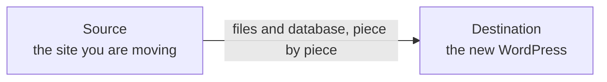

<div align="center">

<p align="center"><picture><source media="(prefers-color-scheme: dark)" srcset="docs/assets/panelalpha-migrator.svg"></picture></p>

<h1>Move a WordPress site.<br>Files, database and all.</h1>

<h3>
One plugin on both sites. One address to paste. No FTP, no SQL dump.
</h3>

<h3>
<a href="#three-simple-steps"><b>Get started</b></a> ·
<a href="docs/README.md"><b>Documentation</b></a>
</h3>

<p>
<a href="#what-moves-and-what-stays">What moves</a> ·
<a href="#two-ways-to-run-it">Dashboard or API</a> ·
<a href="#faq">FAQ</a>
</p>

<p>

<a href="#before-you-start"></a>
<a href="#before-you-start"></a>
<a href="docs/03-api/migrate-over-the-api.md"></a>
<a href="#license"></a>
</p>

</div>

## What is PanelAlpha Migrator?

PanelAlpha Migrator is a WordPress plugin that copies a whole site, its files and its database, from the server it runs on now to another WordPress installation, usually a new site on a PanelAlpha server. You install it on both sites, copy one address from the new site, paste it into the old one, and start. PanelAlpha uses the same plugin to run migrations for you, without a browser.



- **No size limits to fight.** Files and tables travel in small pieces, each checked on arrival, so a large site does not hit upload or time limits.
- **The new address, everywhere.** The old address is replaced with the new one in the database while it is sent, including inside saved plugin settings.
- **The destination keeps its own setup.** Its `wp-config.php` and `.htaccess` stay, so it still connects to its own database.
- **Pause and pick up again.** A migration that stopped continues from where it stopped, not from the start.
- **Before the DNS switch.** Send to the new server's IP address while the domain still points at the old one.

## Three simple steps

### Before you start

- Two WordPress sites: the **source** you are moving, and the **destination** it moves to. The destination can be a fresh, empty install.
- An administrator login on both, and PHP 7.4 or newer with the cURL extension.
- WordPress must be able to write to `wp-content` on both sites.

> **The migration replaces the destination site.** Each table the source has is deleted on the destination and recreated from the source, and files with the same path are overwritten. Afterwards you log in to the destination with the source site's usernames and passwords.

### Step 1: Install the plugin on both sites

Download `panelalpha-migrator.zip` from the [latest release](https://github.com/panelalpha/panelalpha-wordpress-migrator/releases/latest). In WordPress, open **Plugins** > **Add New Plugin** > **Upload Plugin**, upload the zip, then select **Activate** under **PanelAlpha Migrator**. A **Migrator** item appears in the dashboard menu. [Install the plugin](docs/01-getting-started/install.md)

> **Use the release zip, not the source code.** The zip includes the `vendor` folder. A copy of the repository does not, and without `vendor` the plugin activates but shows no **Migrator** menu. To install from the repository anyway, run `composer install --no-dev` in the plugin folder first.

### Step 2: Copy the address from the destination

On the destination, open **Migrator**, select the download icon (**Destination**), then **Copy**. The address appears on its own; use **Generate New Token** only if you need to invalidate an old one:

```text
https://new-site.example.com?token=<token>
```

Treat it like a password: anyone who has it can write to the destination.

### Step 3: Paste it on the source and start

On the source, open **Migrator**, keep the upload icon (**Source**), paste the address and select **Start Migration**. Keep the tab open until you see:

> **Migration Completed Successfully!**
> Files Migrated · Tables Migrated · Total Data · Duration

Then open the destination and check it: [Check the result](docs/01-getting-started/after-the-migration.md).

## What moves and what stays

| Copied from the source | Kept on the destination |
|:---|:---|
| Every table in the source database | `wp-config.php`, with the destination's database login |
| Every file in the site folder, with permissions and dates | `.htaccess` in the site folder, with the destination's server rules |
| Hidden files, such as `.user.ini` | The migrator plugin, with its own token and settings |
| Your uploads, themes and plugins | Tables that exist only on the destination |

`node_modules`, `.git` and `.svn` folders are always left out. Leave out more, such as `*.log` or a cache folder, under **Advanced Options**. [What gets moved](docs/02-guides/what-gets-moved.md)

## Two ways to run it

| Detail | From the dashboard | Over the API |
|:---|:---|:---|
| **Who starts it** | You, on the source's **Migrator** page | PanelAlpha, a script, or `migrate.php` |
| **What drives it** | The open browser tab | Repeated `process-batch` calls |
| **Resume** | **Resume Backup**, in the same browser | Call `process-batch` again with the same ID |
| **Extras** | IP address, exclusions, database or files only | The same, plus `force`, `base64` and `.htaccess` transfer |
| **Guide** | [Migrate a site](docs/01-getting-started/migrate-a-site.md) | [Migrate over the API](docs/03-api/migrate-over-the-api.md) |

## FAQ

<details>
<summary><b>Will it overwrite what is already on the destination?</b></summary>

Yes. Every table the source has is recreated on the destination, and files with the same path are overwritten. Tables and files that exist only on the destination are left alone. Back up the destination first if it holds anything you want to keep. [Migrate a site](docs/01-getting-started/migrate-a-site.md#before-you-start)
</details>

<details>
<summary><b>Can I migrate before the domain points at the new server?</b></summary>

Yes. Enter the new server's IP address in **Destination IP Address (Optional)** and paste the address with the final domain. The plugin connects to that IP address and the migrated site gets the final domain. If the new server has no valid HTTPS certificate for the domain yet, tick **Do not verify the HTTPS certificate (only with a manual IP)** under the IP field. [The new domain does not point at the destination yet](docs/01-getting-started/migrate-a-site.md#the-new-domain-does-not-point-at-the-destination-yet)
</details>

<details>
<summary><b>My browser closed halfway. Do I start again?</b></summary>

No. Open **Migrator** on the source in the same browser and select **Resume Backup** under **Interrupted Migration Detected**. What was already sent is not sent again. [Stop and resume](docs/02-guides/stop-and-resume.md)
</details>

<details>
<summary><b>Which login works on the destination afterwards?</b></summary>

The source site's. The user accounts are part of the database, so they are copied with it. [Check the result](docs/01-getting-started/after-the-migration.md)
</details>

<details>
<summary><b>What about my redirects in .htaccess?</b></summary>

The dashboard never copies the main `.htaccess`, so the destination keeps its own. Copy your own lines over by hand, or send the file over the API with `transfer-htaccess`. [Send the .htaccess file](docs/03-api/migrate-over-the-api.md#send-the-htaccess-file)
</details>

<details>
<summary><b>Should I keep the plugin installed afterwards?</b></summary>

No. While it is active, the destination accepts writes from anyone with its address and token. Deactivate and delete it on both sites once you are happy with the result. Deleting it from the dashboard also removes its settings, token and temporary files. [Remove the plugin](docs/01-getting-started/after-the-migration.md#remove-the-plugin)
</details>

## Documentation

| Section | What is in it |
|:---|:---|
| **[Getting started](docs/01-getting-started/install.md)** | Install the plugin, run a migration, check the result. |
| **[Guides](docs/02-guides/what-gets-moved.md)** | What is copied and what is left out, how to stop and resume. |
| **[API](docs/03-api/migrate-over-the-api.md)** | Run a migration without a browser, and every endpoint. |
| **[Contributing](CONTRIBUTING.md)** | Set up the code, run the tests, send a pull request. |

## License

PanelAlpha Migrator is licensed under GPL v2 or later. See [LICENSE](LICENSE).
