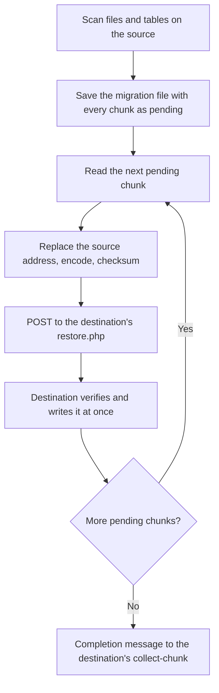

# Data transfer

Developer notes for WordPress Migrator 1.1.4: how the source cuts a site into pieces (chunks), how each piece reaches the destination, and how the destination writes it. The components named here are described on [Architecture](architecture.md).

## Overview



The destination does not wait for the whole site. Every chunk is written into the database or the file system as soon as it arrives ("collect and restore"). Only the migration info and the completion message are stored as files there.

## Scan

`FileScanner` walks `PathProvider::getAbsPath()` recursively with `SKIP_DOTS`, so hidden files are included. For each file it records the relative path, size, permissions (three octal digits) and modification time (ISO 8601), and splits the file into chunks of **532,480 bytes** (`FileScannerConfig::CHUNK_SIZE`).

`DatabaseScanner` runs `SHOW TABLES` with no prefix filter, then records each table's size from `information_schema`, its row count, `SHOW CREATE TABLE` and its indexes. A table is split into chunks of **100 rows** (`DatabaseScanner::ROWS_PER_CHUNK`); an empty table still gets one chunk.

Exclusions:

- Always, in `RouteProvider::getDefaultExclusions()`: folders `node_modules`, `.git`, `.svn`, `wp-content/migrations`, `wp-content/plugins/wordpress-migrator`; files `wp-config.php`, `.htaccess` (main folder only).
- API path only: `DefaultExclusions` adds `.htaccess`, `wp-config.php`, `wordpress-migrator` and the plugin path, and splits the user's list on commas and new lines. Through `ExclusionParser`, `.htaccess` becomes the extension `htaccess` (every `.htaccess` in any folder) and `wordpress-migrator` a folder name anywhere.
- User entries, parsed by `ExclusionParser` line by line: `*.ext` or `.ext` is an extension; a value with `/` or `\`, or without a dot, is a folder (matched as a path prefix or as a name anywhere); anything else is a file matched from the root. The dashboard sends the textarea as typed, so comma-separated entries on one line are read as a single extension.
- On the destination, `FileRestoreHandler` refuses `wp-config.php`, `.htaccess`, `wp-content/migrations/` and `wp-content/plugins/wordpress-migrator/` regardless of what the source sends (prefix match on the relative path).

The result is saved on the source as `wp-content/migrations/mig_YYYYMMDD_HHMMSS.json`. Keys are shortened by `JsonCompressor` (for example `du` for the destination URL, `stp` for the source table prefix, `bm` for `binary_map`). Every chunk carries `status: pending`, and becomes `sent` once the destination answers with 2xx. A file that no longer exists when it is read is marked `skipped` with all its chunks.

## Database chunks

For each table the first chunk sent is `table_structure` with the `CREATE TABLE` statement and indexes. Then `table_data` chunks follow:

1. `SELECT * FROM <table> LIMIT 100 OFFSET <n>` with `PDO::FETCH_NUM`, plus the column names.
2. `ChunkDomainReplacer` replaces the source URL with the destination URL in every value: `https://` and `http://` variants (each keeps its own scheme), their `urlencode` forms and their `addslashes` forms. Serialized values are unserialised, replaced recursively and serialised again, so string lengths stay right. A serialized value that contains an object whose class is not loaded (`__PHP_Incomplete_Class`) is left untouched.
3. `BinarySafeEncoder` base64-encodes any value that is not valid UTF-8 and lists its `[row, column]` in `binary_map`.
4. The checksum is SHA-256 of `json_encode` of the rows, with `serialize_precision = -1` so floats hash the same on both sides.

Every database chunk carries `source_table_prefix`.

On the destination, `TableRestoreHandler`:

- remaps the table name (and the name inside `CREATE TABLE`) from the source prefix to the prefix in the destination's `wp-config.php` when the two differ. Rows, option names and user meta keys are not rewritten.
- for `table_structure`: `DROP TABLE IF EXISTS`, then the statement after `CreateStatementNormalizer` (removes `TABLESPACE`, `TYPE=`, `PACK_KEYS=`, fixed/compressed/redundant/compact `ROW_FORMAT`, and forces `ENGINE=InnoDB`).
- for `table_data`: verifies the checksum, decodes `binary_map`, and runs `REPLACE INTO` row by row with a prepared statement.
- runs with `sql_mode = 'NO_AUTO_VALUE_ON_ZERO'` and `FOREIGN_KEY_CHECKS = 0`.

## File chunks

`FileBackupService` reads `size` bytes at `offset`, sends them base64-encoded with the SHA-256 of the raw bytes, the relative path, permissions and modification time.

`FileRestoreHandler` first passes the relative path through `FilePathConfinement`, which collapses `.` and `..` without touching the disk and rejects an empty path, an absolute path, a drive prefix such as `C:`, and any path that ends up outside the WordPress folder. A rejected path writes nothing and fails the chunk: `restore.php` answers 500 with `Processing failed: File path is outside the WordPress directory`. The collapsed path is also what the exclusion list is checked against, so `wp-content/../wp-config.php` is refused like `wp-config.php`. Then it decodes, verifies the checksum, creates missing folders with `0755`, writes chunk 1 with `file_put_contents` and appends later chunks with `FILE_APPEND`. After the last chunk it applies the permissions and the modification time. The file is written in place, with no temporary name. A chunk that cannot be written (folder not creatable or not writable) is marked restored and logged to `wp-content/migrations/skipped_files_<migration_id>.log` on the destination.

## Transport

Each chunk is a POST to `<destination>/wp-content/plugins/wordpress-migrator/restore.php?action=collect-and-restore`, with `X-Migrator-Token`, a 120-second timeout and TLS verification off.

- Default: `Content-Type: application/json`, the compressed JSON as the body.
- With `base64: true` (API only): `Content-Type: application/octet-stream`, `X-Migrator-Encoding: base64`, the JSON base64-encoded. Added for WP Cloud, whose firewall blocked raw chunks. `restore.php` also detects a body that does not start with `{` or `[` and decodes it.
- With `ip`: the host is pinned to that IP address with `CURLOPT_RESOLVE`.

The destination answers `{"success": true, "chunk_type": …, "chunk_id": …, "processed": true, "result": …}`, or an `error` with 400, 401, 403 or 500.

## Destination bookkeeping

```text
wp-content/migrations/collected/<migration_id>/
├── migration_info.json      the info piece (dashboard path only)
├── status.json              received and restored counts per file and table
└── migration_complete.json  the completion message
```

`MigrationRegistry` keeps `status.json`. Status moves through `collecting`, `restoring` and `restored`; each item moves through `pending`, `receiving`, received and restored.

## Completion

When every chunk is `sent`, `MigrationFinalizer` builds a summary (files, tables and chunks sent, failed and skipped, sizes, duration) and POSTs a `migration_complete` message to the destination's `/wp-json/wp-migrator/v1/collect-chunk`, without a token. The destination saves it as `migration_complete.json`. Domain replacement already happened on the source, so nothing else runs on the destination.

`.htaccess` from the source's root is sent only on request, by `transfer-htaccess`, to the destination's `receive-htaccess` with the token. It overwrites the destination's file. If `/wp-json/` answers 404, the request is retried at `?rest_route=/wp-migrator/v1/receive-htaccess`.
